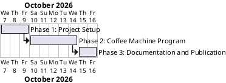

# Project Plan: OOP Coffee Machine

## Metadata
| Key | Value |
| --- | --- |
| ID | PP-001 |
| CrossReference | [BC-001], [SA-001], [MIL-001], [MIL-002], [MIL-003] |
| Language | en |
| Domain | it |

## Version History
| Date | Status | Author | Reviewer | Change | Commit |
| --- | --- | --- | --- | --- | --- |
| 2026-10-07 | Deprecated | Jens Tirsvad Nielsen | S01 | Initial version | [c24f412] |
| 2026-10-07 | Accepted | Jens Tirsvad Nielsen | S01 | Accepted after RC-006 (Go) | [c24f412] |

---

## Purpose

Schedules the three phases that deliver the coffee machine repository, as
required by [BC-001], with the communication cadence of [SA-001].

## Planning Assumptions

- Start date 2026-10-07; one phase per week or less, each ending in a pull request.
- S01 is owner and reviewer of every phase; S02 and S03 are informed through the README.
- Nothing under `src/` or `tests/` is written until the milestones are `Accepted` with a `Go` review.

## Gateway Schedule

| Gateway | Document | Window | Decision date | Owner | Stories | Main deliverable | Milestone |
| --- | --- | --- | --- | --- | --- | --- | --- |
| Phase 1: Project Setup | [MIL-001] | 2026-10-07 to 2026-10-09 | 2026-10-09 | S01 | None | Skeleton, `pyproject.toml`, Doxyfile, CI | |
| Phase 2: Coffee Machine Program | [MIL-002] | 2026-10-10 to 2026-10-14 | 2026-10-14 | S01 | None | Menu, CoffeeMaker, MoneyMachine, main loop, tests | |
| Phase 3: Documentation and Publication | [MIL-003] | 2026-10-15 to 2026-10-16 | 2026-10-16 | S01 | None | README, Doxygen docs, repository description and topics | |

## Timeline diagram

## Scope Coverage

| Business Case scope item | Gateway |
| --- | --- |
| Package, tests, `pyproject.toml`, `.gitignore`, `constants.py`, Doxyfile | [MIL-001] |
| Coffee machine program and tests | [MIL-002] |
| README, Doxygen build | [MIL-003] |
| Repository description and topics | [MIL-003] |

## Dependencies

[MIL-001] precedes [MIL-002], which precedes [MIL-003]. A No-Go on a phase moves every later date by the rework time.

## Plan Risks

| Risk | Impact | Mitigation |
| --- | --- | --- |
| Review of each document delays the next phase | Medium | S01 reviews in the same session as the draft |
| The git host token cannot set topics through the API | Low | Set the description and topics by hand in the web UI |

## Open Issues

- Dates are proposals; S01 confirms or changes them.
- Tasks are all plain tasks: the course supplies the design, so no use case or user story is modelled. S01 may ask for a use case "User orders a drink".
- `PP` has no QC checklist yet; the plan is validated against the Go / No-Go criteria of each milestone.
- Which remote receives the repository description and topics (`git.tirsystem.com`, GitHub mirror, or both) is for S01 to confirm; both remotes exist.

---

[BC-001]: ./business-case.md
[SA-001]: ./stakeholder-analysis.md
[MIL-001]: ./milestones/mil-001-setup.md
[MIL-002]: ./milestones/mil-002-core.md
[MIL-003]: ./milestones/mil-003-docs.md
[c24f412]: https://git.tirsystem.com/Tirsvad-Udemy-100_days_of_code/016-oop_coffee_machine/commit/c24f41207fb15f39b0ad6501e1f3126d3bd9232e
